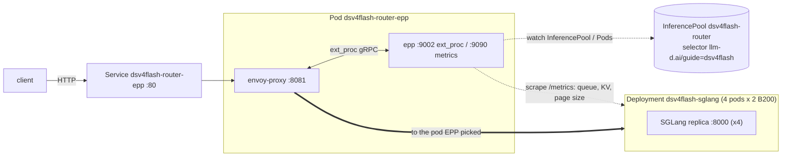

<!--
Copyright Amazon.com, Inc. or its affiliates. All Rights Reserved.
SPDX-License-Identifier: MIT-0
-->

# DeepSeek-V4-Flash on SGLang behind the llm-d router (B200, EKS)

This sample runs four SGLang replicas of `deepseek-ai/DeepSeek-V4-Flash-0731` (`tp=2` each, DSpark speculative decoding) on one `p6-b200.48xlarge`. They sit behind the [llm-d](https://github.com/llm-d/llm-d) router configured as in the v1.0.0 [`optimized-baseline`](https://github.com/llm-d/llm-d/tree/v1.0.0/guides/optimized-baseline) guide. An `InferencePool` selects the replicas by label, and the Endpoint Picker (EPP) picks a replica for every request by prefix-cache affinity and token load. Pods join the pool when they turn Ready and leave when they stop being Ready, so scaling needs no router change.



| Path | What it is | Details |
| --- | --- | --- |
| [`modelserver/`](./modelserver) | Helm chart for the SGLang replicas and an optional AIPerf client pod | [`values.yaml`](./modelserver/values.yaml) comments |
| [`router/`](./router) | Values for the llm-d `llm-d-router-standalone` chart: two verbatim upstream files, this sample's overrides, and the optional flow-control overlay | [`router/README.md`](./router/README.md) |
| [`monitoring/`](./monitoring) | Grafana dashboards (serving, flow control) for the EKS managed observability stack | [Monitoring](#monitoring-optional) |
| [`TEST_RESULTS.md`](./TEST_RESULTS.md) | How this sample was verified: environment, commands, output | |

## Prerequisites

- EKS with a `p6-b200.48xlarge` node, the NVIDIA device plugin, and the node tainted `nvidia.com/gpu:NoSchedule`.
- `kubectl` and Helm ≥ 3.8 (OCI charts).
- Local NVMe for the 156 GB of weights: `/opt/dlami/nvme` on HyperPod, or `/mnt/k8s-disks/0` on self-managed EKS after `/usr/bin/setup-local-disks raid0 --no-bind-mounts` on the node.
- About 8 CPU free for the router pod (it tolerates the GPU node).

Pre-stage the weights (on self-managed EKS, set the DaemonSet `hostPath` to `/mnt/k8s-disks/0`):

```bash
cd examples/inference/llm-d/dsv4flash
../../sglang/download-model.sh deepseek-ai/DeepSeek-V4-Flash-0731 p6-b200.48xlarge
kubectl logs -f -l app=model-downloader     # wait for "Download complete!"
kubectl delete daemonset model-downloader
```

## Deploy

Run from this directory:

```bash
export NS=dsv4flash-llmd
export NVME_HOST_PATH=/mnt/k8s-disks/0     # /opt/dlami/nvme on HyperPod
```

1. Install the `InferencePool` CRD (Gateway API Inference Extension v1.6.2):

   ```bash
   kubectl apply -f https://github.com/kubernetes-sigs/gateway-api-inference-extension/releases/download/v1.6.2/v1-manifests.yaml
   ```

2. Install the SGLang model servers:

   ```bash
   helm upgrade --install dsv4flash-sglang ./modelserver -n $NS --create-namespace \
     --set nvmeHostPath=$NVME_HOST_PATH
   ```

3. Install the llm-d router:

   ```bash
   helm upgrade --install dsv4flash-router oci://ghcr.io/llm-d/charts/llm-d-router-standalone \
     --version v1.0.0 -n $NS \
     -f router/upstream/base.values.yaml \
     -f router/upstream/optimized-baseline.values.yaml \
     -f router/values.yaml
   ```

4. Wait for the replicas (cold start ~12 min, warm restart ~3 min):

   ```bash
   kubectl -n $NS rollout status deploy/dsv4flash-sglang --timeout=45m
   kubectl -n $NS get inferencepool,deploy,pods,svc
   ```

## Verify

EPP should see 4 ready replicas, and a request through the router should return `391`:

```bash
kubectl -n $NS get endpointslices -l kubernetes.io/service-name=dsv4flash-router-epp-model-servers \
  -o jsonpath='{range .items[*].endpoints[*]}{.addresses[0]} ready={.conditions.ready}{"\n"}{end}'   # 4 x ready=true

kubectl -n $NS port-forward svc/dsv4flash-router-epp 8080:80 &
curl -s localhost:8080/v1/chat/completions -H 'Content-Type: application/json' -d '{
  "model": "deepseek-ai/DeepSeek-V4-Flash-0731",
  "messages": [{"role": "user", "content": "What is 17*23? Answer with the number only."}],
  "max_tokens": 64}' | python3 -m json.tool
```

Repeating a long prompt should show `usage.prompt_tokens_details.cached_tokens` covering almost all of it from the second request on (prefix affinity).

## Benchmark

Run a 300 s AIPerf AgentX smoke test at c=64 from the client pod:

```bash
helm upgrade dsv4flash-sglang ./modelserver -n $NS --reuse-values --set bench.enabled=true   # replicas untouched
kubectl -n $NS logs -f dsv4flash-sglang-bench      # wait for "aiperf ready"

kubectl -n $NS exec dsv4flash-sglang-bench -- bash -c '
  export AIPERF_DATASET_CONFIGURATION_TIMEOUT=3600 AIPERF_SERVICE_PROFILE_CONFIGURE_TIMEOUT=3600 \
         AIPERF_HTTP_KEEPALIVE_TIMEOUT=30 AIPERF_HTTP_TCP_USER_TIMEOUT=900000
  cd /nvme && /opt/aiperf/bin/aiperf profile \
    --scenario inferencex-agentx-mvp \
    --url http://dsv4flash-router-epp.dsv4flash-llmd.svc.cluster.local:80 \
    --model deepseek-ai/DeepSeek-V4-Flash-0731 --tokenizer deepseek-ai/DeepSeek-V4-Flash-0731 \
    --endpoint-type chat --public-dataset semianalysis_cc_traces_weka_062126_256k \
    --concurrency 64 --benchmark-duration 300 --unsafe-override \
    --random-seed 42 --use-server-token-count --artifact-dir /nvme/aiperf-results/c64'
```

Each run starts with a ~10-minute warmup. Use `--benchmark-duration 1800` without `--unsafe-override` for comparable numbers. AIPerf's server-metrics export is unreliable behind the router (it logs `counter reset`), so use its client-side table and the dashboard. Keep `AIPERF_HTTP_KEEPALIVE_TIMEOUT` below every idle timeout on the path, or requests fail with `ECONNRESET`. Remove the pod with `--set bench.enabled=false`.

## Cleanup

```bash
helm uninstall dsv4flash-router -n $NS
helm uninstall dsv4flash-sglang -n $NS
kubectl delete namespace $NS
# Cluster-scoped CRDs. Remove them only if nothing else uses them:
# kubectl delete -f https://github.com/kubernetes-sigs/gateway-api-inference-extension/releases/download/v1.6.2/v1-manifests.yaml
# kubectl delete -f https://github.com/llm-d/llm-d-router/releases/download/v1.0.0/manifests.yaml   # if installed for flow control
```

## Monitoring (Optional)

Monitoring uses the [EKS managed observability](../../../../observability/prometheus-grafana/eks-managed-observability) stack (ADOT collector → Amazon Managed Service for Prometheus → Amazon Managed Grafana). Each panel's description in Grafana says what to look for.

1. Collect the `dcgm-exporter`, `sglang`, and `llmd-epp` scrape jobs:
   - New stack with `deploy-obs.sh`: answer `y` to "Scrape SGLang metrics" and "Scrape llm-d router (EPP) metrics".
   - Manual install, or a stack that is already running: follow [step 6](../../../../observability/prometheus-grafana/eks-managed-observability/README.md#6-deploy-adot-collector) with its "DCGM + SGLang + llm-d router (EPP)" `SCRAPE_CONFIGS` line.

2. In Amazon Managed Grafana, add the AMP data source as in [step 8](../../../../observability/prometheus-grafana/eks-managed-observability/README.md#8-configure-amazon-managed-grafana). Then go to **Dashboards** → **New** → **Import**, upload [`monitoring/dashboard.json`](./monitoring/dashboard.json), select that data source, and pick the namespace (default `dsv4flash-llmd`). With flow control on, import [`monitoring/dashboard_flow_control.json`](./monitoring/dashboard_flow_control.json) the same way.

If panels show no data, check in Grafana Explore that `up{job=~"sglang|epp", namespace="dsv4flash-llmd"}` returns 5 series (4 replicas + EPP) with value 1.

## Flow control and priority (Optional)

With llm-d's flow control on, EPP holds requests once the pool is saturated and releases them by priority as slots free up, instead of letting the backlog form in SGLang's queues. The overlay defines three tiers and admits up to 64 in-flight requests per replica. How it works and why each value was chosen are in [Flow control overlay](./router/README.md#flow-control-overlay).

| `x-llm-d-inference-objective` | Priority |
| --- | --- |
| `premium` | 100 |
| `standard`, or no header | 0 |
| `best-effort` | -10 |

1. Install the `InferenceObjective` CRD from the llm-d-router v1.0.0 release (cluster-scoped, adds resource types only):

   ```bash
   kubectl apply -f https://github.com/llm-d/llm-d-router/releases/download/v1.0.0/manifests.yaml
   ```

2. Re-run [Deploy](#deploy) step 3 with the overlay added last:

   ```bash
   helm upgrade --install dsv4flash-router oci://ghcr.io/llm-d/charts/llm-d-router-standalone \
     --version v1.0.0 -n $NS \
     -f router/upstream/base.values.yaml \
     -f router/upstream/optimized-baseline.values.yaml \
     -f router/values.yaml \
     -f router/flow-control.values.yaml
   ```

3. Check that it is on, and send a premium request for tenant `tenant-a`:

   ```bash
   kubectl -n $NS logs deploy/dsv4flash-router-epp -c epp | grep 'Initializing Flow Control layer'
   kubectl -n $NS get inferenceobjectives    # premium, standard, best-effort

   curl -s localhost:8080/v1/chat/completions -H 'Content-Type: application/json' \
     -H 'x-llm-d-inference-objective: premium' -H 'x-llm-d-inference-fairness-id: tenant-a' \
     -d '{"model": "deepseek-ai/DeepSeek-V4-Flash-0731", "messages": [{"role": "user", "content": "Hi"}], "max_tokens": 16}'
   ```

Requests queue only above 256 in flight (4 replicas × 64). To see priority in effect, follow [Verifying flow control](./router/README.md#verifying-flow-control). To turn flow control off, re-run [Deploy](#deploy) step 3 as written, without the overlay.

## Scaling (Optional)

`helm upgrade dsv4flash-sglang ./modelserver -n $NS --reuse-values --set replicas=N`. Pods join or leave the pool by readiness, with no router change. Prefer this over `kubectl scale`, which the next `helm upgrade` resets.

## Known limitations

- Verified on one B200 node (4 replicas) on EKS only. The chart also accepts the HyperPod node label `ml.p6-b200.48xlarge`, but that is untested.
- The flow-control overlay has not been run on hardware yet. Its `maxConcurrency: 64` comes from the earlier c=256/c=512 runs, not from a run with the overlay.
- Any load balancer between clients and the Service needs an idle timeout as long as the longest time to first token you expect.

Test environment, commands, and output: [TEST_RESULTS.md](./TEST_RESULTS.md).
