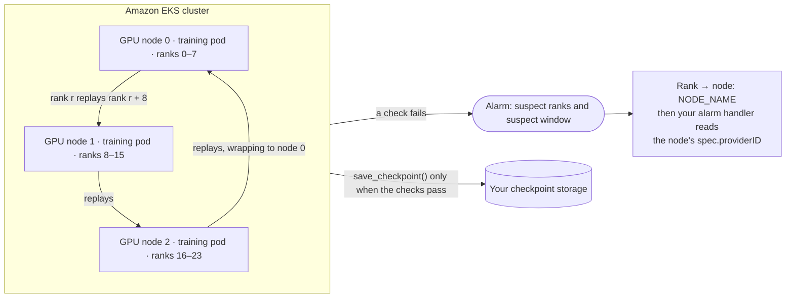
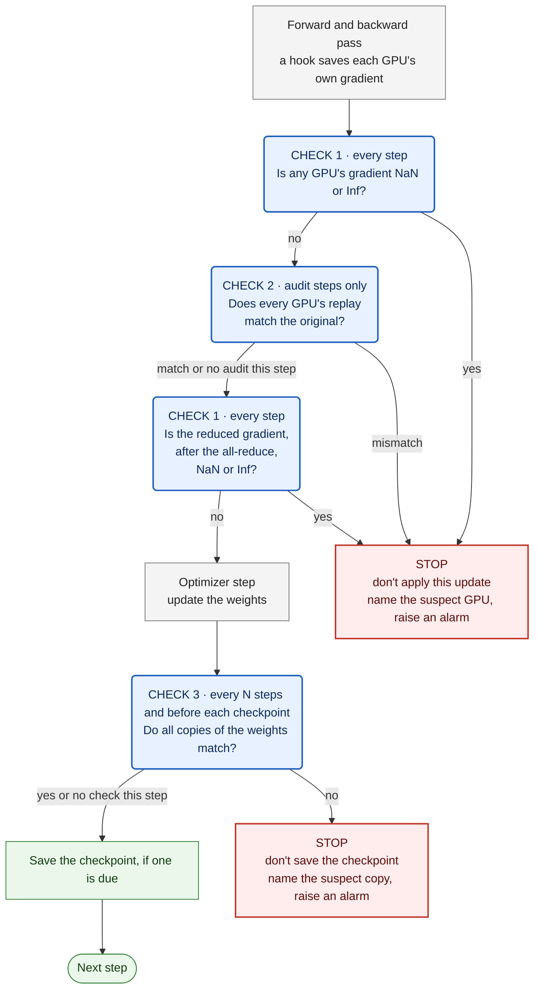

# Detecting silent data corruption in PyTorch DDP training on Amazon EKS

This use case is the companion code for the AWS Machine Learning Blog post *Detecting and recovering from silent data corruption on Amazon SageMaker HyperPod*.

Silent data corruption (SDC) is a wrong result from a GPU that raises no error. `sdc_order.py` adds three complementary checks to a PyTorch `DistributedDataParallel` (DDP) training loop, in a fixed order within each step. When a check fires, `train()` stops and returns an alarm that names the suspect ranks. The use case also contains the fault-injection experiments that test the checks, as a Kubeflow `PyTorchJob`.

The code uses plain PyTorch and Kubernetes, and runs on any Amazon EKS cluster with GPU nodes, including a SageMaker HyperPod cluster orchestrated by EKS. We ran the experiments on a SageMaker HyperPod EKS cluster with 4 and with 3 ml.p5.48xlarge instances.

> **All data in the experiments is synthetic, and every fault is injected in software.** The experiments show that each check behaves as designed. They don't show how often real hardware fails.



*The three checks run inside the training pods, on the minimum setup of three nodes. The response to an alarm (cordon the node, check its GPU metrics, replace it after review) is described in the blog post; nothing in this use case runs it.*



| Check | Runs | Catches | Misses |
|---|---|---|---|
| **1. NaN/Inf gradient** | Every step: each rank's local gradient right after backward, and the reduced gradient after the all-reduce, both before the update | NaN, Inf, or overflow in one GPU's forward or backward pass, on the step it happens, and NaN or Inf that the gradient all-reduce introduces | Any wrong value that stays finite, including a finite error in the all-reduce |
| **2. Ring replay** | Audit steps, before the update. Every rank recomputes the micro-batch of a rank on another node, and compares the loss bits and, with deterministic kernels, every parameter's gradient fingerprint | Finite wrong values that change the loss or a gradient | Faults on steps without an audit, faults that change neither, and faults in the gradient all-reduce |
| **3. Weight fingerprints** | After the update, every N steps and on every checkpoint step | A wrong update or a corrupted stored weight on one copy, named when a strict majority of copies agrees | Wrong updates applied identically to every copy, and sharded weights (ZeRO, FSDP) |

If check 1 or 2 fires, the step that raised it isn't applied; earlier steps since the last passing audit may have been. If check 3 fires, the checkpoint isn't saved.

**Fingerprints** are two 64-bit sums per tensor, of the raw bit patterns and of the bit patterns weighted by position. Any change to one or two elements of a tensor changes them (for tensors with fewer than 2³² elements of up to 4 bytes). Larger changes could, in principle, cancel out, so equal fingerprints are strong evidence of equal tensors, not proof.

## Directory layout

| Path | What it is |
|---|---|
| `sdc_order.py` | The three checks and the training loop that runs them in order. Copy it next to your training script |
| `experiments/run_order.py` | The test driver: fault scenarios, checks of the checks, healthy runs, and timing |
| `experiments/faults.py` | Software fault injection: forward, backward-only, and stored-weight faults |
| `experiments/model.py` | The 953M-parameter Llama-style test model |
| `experiments/common.py` | Process group, configuration, synthetic data, and snapshots |
| `experiments/gen_job.py` | Writes the Kubeflow `PyTorchJob` manifest |
| `experiments/job.sh` | Preflight, push, start, wait, fetch, stop, and clean up |
| `experiments/analyze.py` | Summarizes a fetched run: scenarios, healthy runs, the outlier-test analysis, and schedule costs (estimated from per-step medians, and measured) |

## Use the checks in your training loop

Requirements:

- **PyTorch DDP.** Tested with PyTorch 2.9.0 and NCCL 2.27.7. For other parallelism layouts, see [Limitations](#limitations).
- **At least three nodes, numbered node by node.** The ring audit settles an ambiguous comparison with a GPU on a third node, and the weight comparison needs three copies of each weight to name the odd one out. `train()` calls `check_topology()` at start and raises an error unless every replayer, target, and confirming GPU sit on three different nodes. Set `peer_offset` to the GPUs per node.
- **`NODE_NAME` in each pod,** from the downward API (`spec.nodeName`). `check_topology()` uses it to tell nodes apart; without it, it falls back to the hostname, which is wrong when two pods share a node.
- **Rebuildable micro-batches.** `rebuild_batch(step, rank)` must return exactly the micro-batch that rank trained on, so use a seeded sampler, not a stateful iterator.
- **One loss function.** `compute_loss(model, batch)` must be the same function in training and in replay, including autocast. Seed any randomness in it per step and rank, or the replay can't match.
- **No collectives or output-affecting state in the model.** The confirmation replay runs on only two ranks (the target and the third GPU), so a model that calls a collective inside its forward or backward (`SyncBatchNorm`, for example) hangs on an ambiguous alarm, and a buffer that the forward both reads and updates makes a healthy replay differ.
- **Deterministic kernels for audits:** `CUBLAS_WORKSPACE_CONFIG=:4096:8` set before the process starts. On deterministic audit steps, an op without a deterministic implementation raises an error rather than producing a false alarm.

A training script calls it like this. This snippet shows the interface; it wasn't run as written. The test driver, `experiments/run_order.py`, calls `train` the same way.

```python
import sys
import torch
import torch.distributed as dist
import torch.nn.functional as F
import sdc_order as S

stats = S.attach(ddp_model, dp_group)                 # registers the comm hook, once
sched = S.Schedule(audit_every=10, deterministic_audits=True, check_every=10,
                   ckpt_every=100, peer_offset=8)    # 8 = GPUs per node

def compute_loss(model, batch):                      # used for training AND replay
    x, y = batch
    with torch.autocast("cuda", dtype=torch.bfloat16):
        logits = model(x)
    return F.cross_entropy(logits.float().flatten(0, 1), y.flatten())

def rebuild_batch(step, rank):                       # exactly the micro-batch `rank` trained on
    return dataset.micro_batch(step, rank)

def batches(start):                                  # set the LR here; train() doesn't
    for step in range(start, total_steps):
        for g in optimizer.param_groups:
            g["lr"] = lr_schedule(step)
        yield rebuild_batch(step, dist.get_rank())

alarm = S.train(ddp_model, stats, optimizer, batches(start), compute_loss, rebuild_batch,
                save_checkpoint, sched, start_step=start)
if alarm is not None:
    report_sdc(alarm)                                # metric + log line; then map the rank to a node
    sys.exit(3)
```

`train` returns `None` when `batches` runs out, or the first alarm as a dictionary:

| Key | Compute-path alarm (`"check": "compute"`) | Reduced-gradient alarm (`"check": "reduced gradient"`) | Weight alarm (`"check": "weights"`) |
|---|---|---|---|
| `step` | The step that raised it. It wasn't applied | The step that raised it. It wasn't applied | The step that raised it. Its update was applied; its checkpoint wasn't saved |
| `nonfinite` | Ranks whose local gradient norm was NaN or Inf, including a rank whose float32 sum of squares overflowed (a norm above about 1.8 × 10¹⁹) | — | — |
| `mismatched_pairs` | `(target, replayer)` pairs whose replay didn't match | — | — |
| `culprits` | Ranks in two mismatched pairs. This assumes at most one faulty GPU among the GPUs that replay each other (the GPUs with the same local index); with two, a healthy GPU can be named, alone or with them | — | — |
| `verdicts` | For each ambiguous pair: the third GPU, the suspect, and `persistent` (the target's retry reproduced its wrong result), `transient` (the target's retry came out right; an intermittent fault can look the same), `replayer computed wrong`, `unclear`, or `unattributable` | — | — |
| `suspects` | — | — (no rank is named: nothing here shows which GPU corrupted the all-reduce) | Ranks whose copy differs from a strict majority, or `None` when no strict majority exists |
| `suspect_window` | `[first, last]` steps since the last passing audit | `[step, step]` | `[first, last]` steps since the last passing weight check |
| `last_audit_pass`, `last_weight_check_pass` | The last step each check passed | The same | The same |

Checkpoints are tagged with `last_audit_pass` and `last_weight_check_pass`. To recover, load the newest checkpoint saved at a step before `suspect_window[0]`. That predates a fault that was active on every step since it began. An intermittent fault can be older, and replica agreement can't show common-mode corruption, so treat the tags as a record that the checks passed at that step, not as proof that the saved state is clean.

On resume, call `S.find_divergent_ranks(params, dp_group)` once after loading a checkpoint and before the first step, to check that every copy loaded the same weights.

To act on an alarm, map the suspect rank to its node with the rank's `NODE_NAME`. The node's `spec.providerID` has the form `aws:///<availability-zone>/<instance-id>`, which gives the EC2 instance. On a SageMaker HyperPod cluster, the node name itself is `hyperpod-<instance-id>`. The blog post describes the proposed response: cordon the node, check its GPU metrics, run a deep health check when the alarm is ambiguous, and replace the node after review. Nothing in this use case does any of those.

### Choose a schedule

`audit_every` is the main setting:

- **Detection delay:** a persistent finite fault is caught within `audit_every` steps if it also occurs in the kernels the audit runs. Deterministic audits run deterministic kernels and the math attention backend on audit steps, so a fault confined to the default kernels used on the other steps is never audited.
- **Corrupted updates:** up to `audit_every − 1` corrupted updates can be applied before the audit catches it. They fall inside the alarm's `suspect_window`.
- **One-time faults:** a finite fault on a single non-audit step that doesn't recur isn't caught at all.

Make `ckpt_every` a multiple of both `audit_every` and `check_every`, so every checkpoint step is audited before its update and fingerprinted after it. Keep `check_on_checkpoint=True`. In our tests, turning it off let a checkpoint be saved from a corrupted copy.

Measured cost on the 953M test model and 32 H100s: the average step time over 1,000 consecutive steps per schedule, after 20 warm-up steps. Every schedule with the checks also runs the weight check every 10 steps. `run_order.py` measures these in every run (`schedule_costs` in the `analyze.py` output).

| Schedule | Average step time | Over plain DDP |
|---|---|---|
| Plain DDP, no checks | 157.4 ms | — |
| Checks, no audits | 169.0 ms | +7.4% |
| Deterministic audits every 10 steps | 211.9 ms | +34.7% |
| Default-kernel audits every 10 steps | 177.0 ms | +12.5% |
| Deterministic audits every 100 steps | 173.3 ms | +10.1% |
| Default-kernel audits every 100 steps | 169.3 ms | +7.6% |

About 7 percentage points of each schedule's cost don't depend on audits: the gradient hook and the two NaN/Inf checks on every step, and the weight check every 10 steps. A reasonable starting point for production is deterministic audits every 100 steps (10% here). They still catch a persistent fault within 100 steps, including a backward-only one, at the price of up to 99 corrupted updates to roll back. Audit every 10 steps when you need faster detection, for example during a burn-in on new capacity or while you watch a suspect node.

Default-kernel audits compare the loss only, so they miss faults that occur only in the backward pass. Measure the cost on your own model: deterministic attention uses the math kernel, whose cost grows with the square of the sequence length.

In fault-free runs on 4 and 3 instances (30,800 steps, 15,320 of them audited, and 3,080 weight checks; most audit steps come from runs that audit every step), the checks raised no alarm. That bounds the false-alarm rate at about 1 in 5,100 audit steps (95% confidence), not lower.

## Reproduce the experiments

Prerequisites:

- An Amazon EKS cluster with at least three idle GPU nodes of the same instance type, with 8 GPUs each. The fault scenarios inject faults on fixed ranks that assume 8 GPUs per node. We used p5.48xlarge. A [SageMaker HyperPod cluster orchestrated by EKS](../../../architectures/sagemaker-hyperpod-eks) works too.
- The [Kubeflow Training Operator](https://github.com/kubeflow/trainer/releases/tag/v1.9.4) v1 for `PyTorchJob`, for example v1.9.4: `kubectl apply --server-side -k "github.com/kubeflow/trainer.git/manifests/overlays/standalone?ref=v1.9.4"`. On SageMaker HyperPod, the HyperPod Helm chart installs it.
- The NVIDIA device plugin, and the EFA device plugin. We ran the experiments only on nodes with EFA. `gen_job.py --efa-per-node 0` leaves out the EFA settings, but that path is untested.
- `kubectl` pointed at the cluster, with permission to create a namespace (or use an existing one), a ConfigMap, a `PyTorchJob`, and `pods/exec`. Python 3 locally.

The job uses the [AWS Deep Learning Containers](https://github.com/aws/deep-learning-containers/blob/master/available_images.md) PyTorch training image for us-east-1, pinned by digest. In other Regions, pass `--image` with your Region's URI. The code reaches the pods through a ConfigMap, so there's no image to build.

`job.sh` selects GPU nodes with `SELECTOR`, which defaults to `node.kubernetes.io/instance-type=p5.48xlarge`. On SageMaker HyperPod, the instance type has an `ml.` prefix, so set `SELECTOR=node.kubernetes.io/instance-type=ml.p5.48xlarge`. If your GPU nodes are tainted, list the taints the pods should tolerate in `TOLERATIONS`, for example `TOLERATIONS="nvidia.com/gpu:NoSchedule"`. `preflight` counts a node as idle only if it has no GPU requests, isn't cordoned, and has no `NoSchedule` or `NoExecute` taint outside `TOLERATIONS`, and `start` passes both settings to `gen_job.py`.

```bash
git clone https://github.com/awslabs/awsome-distributed-ai.git
cd awsome-distributed-ai/examples/use-cases/pytorch-ddp-sdc-detection/experiments

export EXPECTED_CONTEXT=<your kubectl context>   # job.sh refuses to run against any other context
export SELECTOR=node.kubernetes.io/instance-type=p5.48xlarge
./job.sh preflight 4                       # PyTorchJob CRD present, 4 idle GPU nodes
./job.sh push                              # namespace sdc-detection (if needed), ConfigMap with the code

JOB=$(./job.sh start --smoke)              # small model: about 3 minutes once the pods start
./job.sh wait "$JOB" 1800 && ./job.sh fetch "$JOB"

JOB=$(./job.sh start)                      # the full run: about 2 hours 20 minutes on 4 x p5.48xlarge
./job.sh wait "$JOB" && ./job.sh fetch "$JOB"
python3 analyze.py "runs/$JOB/files"
```

For three instances, run `./job.sh preflight 3` and `JOB=$(./job.sh start --nodes 3 --healthy-minutes 15)`, which takes about 65 minutes. `python3 gen_job.py --help` lists the other options, such as `--efa-per-node`, `--cpu`, `--memory`, and `--toleration`.

`wait` fails on a timeout, a failed pod, or a nonzero `torchrun` exit. `fetch` copies the logs, the job manifest, the image digests, and the results to `runs/<job>/`, and then lets the rank-0 pod exit; the pod otherwise exits after 30 minutes. The manifest sets `ttlSecondsAfterFinished` to 3 days, after which the training operator deletes the finished job.

The job runs only inside your cluster. Its pods get no service-account token, run with the `RuntimeDefault` seccomp profile and without privilege escalation, and need no AWS credentials. Nothing in the experiments cordons, health-checks, reboots, or replaces a node.

### Expected results

`analyze.py` prints a `scenarios` list. Compare each entry's `alarm_rel_step` (the alarm step, counted from the snapshot after warm-up), `check`, and named ranks with this table; timings will differ. Faults are injected in `blocks.7.mlp.down`. Unless noted, audits run every 10 steps with deterministic kernels, weight checks every 10 steps, and a checkpoint every 20. These outcomes are the same on 3 and on 4 nodes; only the peer ranks in `mismatched_pairs` and `verdicts` change.

| Scenario | Injected fault | `alarm_rel_step` | `check` | Named ranks |
|---|---|---|---|---|
| `healthy_reference` | None, 50 steps | — | — | — |
| `nan_fwd_r13_once_nonaudit` | NaN in one element of rank 13's forward output, on step 25 only (not an audit step) | 25 | `compute` | `nonfinite` [13]; a verdict of `transient` on 13 |
| `fwd_x1000_r13_persistent` | One element of rank 13's forward output ×1,000, every step from step 23 | 30 | `compute` | `culprits` [13] |
| `fwd_x1000_r13_transient_at_audit` | The same ×1,000 on audit step 30 only | 30 | `compute` | A verdict of `transient` on 13 |
| `fwd_x1000_r5_persistent_faulty_replayer` | The persistent ×1,000 on rank 5, which replays rank 13's micro-batch | 30 | `compute` | `culprits` [5] |
| `fwd_x10000_r13_persistent` | One element of rank 13's forward output ×10,000, every step from step 23 | 30 | `compute` | `culprits` [13] |
| `fwd_noise10pct_r13_persistent` | 10% multiplicative noise on the whole output of rank 13's layer, every step from step 23 | 30 | `compute` | `culprits` [13] |
| `dgrad_x1000_r13_persistent_det` | One element of the gradient flowing into rank 13's layer ×1,000, every step from step 23 (backward only) | 30 | `compute` | `culprits` [13] |
| `wgrad_x1000_r13_persistent_det` | One element of rank 13's weight gradient ×1,000, every step from step 23 (backward only) | 30 | `compute` | `culprits` [13] |
| `wgrad_x1000_r13_persistent_default` | The same, with default-kernel (loss-only) audits | — | — | None: loss-only audits can't see a backward-only fault, and every copy applies the same wrong update |
| `fwd_bf16bit3_r13_persistent_det` and `_default` | Bit 3 flipped in one bf16 element of rank 13's forward output, every step from step 23 | 30 | `compute` | `culprits` [13] |
| `fwd_lane_x1.1_r13_persistent_det` and `_default` | One output column of rank 13's layer ×1.1, every step from step 23 | 30 | `compute` | `culprits` [13] |
| `two_faulty_ranks_fwd_x1000_r13_r22` | The persistent ×1,000 on ranks 13 and 22 at once | 30 | `compute` | `culprits` [13, 22] |
| `weight_bit22_r0_check_on_ckpt` | Bit 22 flipped in one fp32 weight element on rank 0 after the step-31 update; checkpoint every 5 steps | 35 | `weights` | `suspects` [0]; no save at step 35 |
| `weight_bit22_r0_no_check_on_ckpt` | The same, with `check_on_checkpoint=False` | 40 | `compute` | `culprits` [0]; the save at step 35 went ahead from rank 0's corrupted copy |
| `weight_swap_r0_weight_check_only` | Two values swapped in one weight tensor on rank 0 after the step-31 update; no audits | 40 | `weights` | `suspects` [0] |
| `weight_compensate_r0_weight_check_only` | +4,096 and −4,096 added to the bit patterns of two values in that tensor; no audits | 40 | `weights` | `suspects` [0] |

`analyze.py` prints the check on resume separately, under `resume_check`: a bit flipped in one attention weight on rank 7 after the snapshot is restored, as a stand-in for a corrupted checkpoint load, gives `suspects` [7]. In every scenario where check 1 or 2 fires, `state_after` shows that the alarm step left the weights unchanged and that the weights and optimizer state are finite on every rank. They're also identical across ranks, except in `weight_bit22_r0_no_check_on_ckpt`, where rank 0's corrupted copy from before the alarm remains.

## Clean up

```bash
./job.sh clean          # from experiments/: deletes only the jobs and ConfigMap this script labeled
```

`job.sh clean` deletes resources labeled `app.kubernetes.io/part-of=sdc-detection` in the `sdc-detection` namespace (or `$NS`). It leaves the namespace in place; delete it with `kubectl delete namespace sdc-detection` only if you created it for this test. The fetched runs in `experiments/runs/` contain your node names and GPU UUIDs, and `.gitignore` keeps them out of Git; remove or replace those before you share a run.

## Known issues

- **Region:** the default image URI is for us-east-1. In other Regions, `./job.sh start --image <uri>` with the same tag from your Region's Deep Learning Containers registry, pinned by digest.
- **Idle nodes:** `preflight` checks GPU requests, cordons, and taints. Pods can still stay `Pending` for other reasons, such as resource quotas or too little CPU or memory for `--cpu` and `--memory`.
- **Rank-0 pod keeps running after the run:** it waits up to 30 minutes for `fetch`. Run `fetch` promptly, or `./job.sh stop <job>` if you don't need the results.
- **Non-deterministic ops:** with `deterministic_audits=True`, a model that uses an op without a deterministic implementation raises an error on the first audit step. If only the backward pass is non-deterministic, use `deterministic_audits=False` (loss-only audits); those still need a forward pass whose loss is bitwise reproducible.

## Limitations

- **Software faults only:** real SDC can be rarer, smaller, data-dependent, or intermittent. We tested one synthetic task and one model size.
- **Fingerprints, not full comparisons:** changes to more than two elements of a tensor could, in principle, cancel out. The audit compares the loss bit for bit, but a fault that changes neither the loss nor a gradient fingerprint isn't seen.
- **Gaps between audits:** a finite fault on a single non-audit step can't be caught by this design.
- **Common-mode corruption:** a fault that changes every replica the same way passes the weight comparison. That includes a finite error inside the gradient all-reduce, which reaches every replica identically; the reduced-gradient check catches only NaN and Inf.
- **One faulty GPU per replay group:** attribution assumes at most one faulty GPU among the GPUs that replay each other. With two, a healthy GPU can be named.
- **DDP only:** `train()` and the gradient hook work with DDP, and the ring audit was tested only with DDP. `find_divergent_ranks` takes any data-parallel group, so it can compare each shard across its replicas, but this use case doesn't test that.
- **Blind spots:** the weight comparison can't see ZeRO-1/2 owner updates or FSDP full-shard weights, which have no second copy. Nothing here checks optimizer state until it changes an update.
- **Not tested:** a real checkpoint save and load (our saves were a stand-in, and the check on resume ran on an in-memory snapshot), dropout and other stochastic layers, BatchNorm, unused parameters, gradient accumulation, and fp16 training with a gradient scaler. With a scaler, exclude the overflow steps it already skips from check 1.

## Security

See [CONTRIBUTING](../../../CONTRIBUTING.md#security-issue-notifications) for more information.

## License

This sample is licensed under the MIT-0 License. See the [LICENSE](../../../LICENSE) file.
